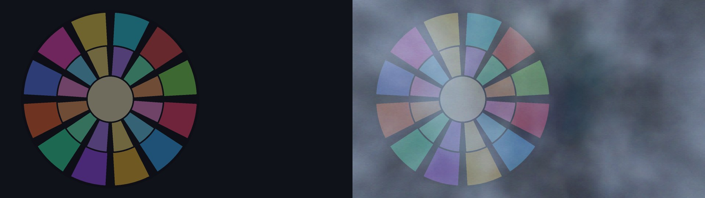

# VolumetricFog3D / 体积雾（3D） / Volumetric Fog (3D)

`VolumetricFog3D.obj2 v2.06` &nbsp;|&nbsp; `VL3DBridge.aux2 v1.22`（可选） &nbsp;|&nbsp; `AviUtl ExEdit2 v2.1.15+` &nbsp;|&nbsp; `MIT License`

[English](docs/README_en.md) | [日本語](docs/README_ja.md)

> 🌫️ **AviUtl ExEdit2 用「真·3D」连续体积雾自定义物件** —— GPU 实时积分的连续三维密度场，绝无圆点粒子感。

## 1. 项目简介与核心特性

在 AviUtl2 的 3D 摄像机空间中直接生成**连续的三维大气雾场**：

- **连续 GPU 三维密度场**：HLSL 像素着色器实时计算 4 阶 3D 分形噪声（fBm）、Beer-Lambert 光学透射率、高度指数衰减与 Henyey-Greenstein 各向异性前向散射——雾是真正连续的介质，不是粒子贴图。
- **硬件 Z 缓冲真 3D 遮挡**：每个切片作为 3D 多边形绘制，与 AviUtl2 本体的硬件深度缓冲直接咬合——手前的石膏像/人物清晰锐利，越远的彩窗与背景被越深的雾包裹，遮挡关系**自动**正确。
- **编辑视点 360° 球体模式**：自动检测预览的「编辑用视角（绿色摄像机图标）」，切换为以注视点为中心的 3D 球体体积——横着绕、斜着转都不会出现「谜之竖条纹」或「断面棱角」。
- **可选 GPU 加速**：配合 [`VL3DBridge.aux2`](https://github.com/CylnaNangong/VolumetricLight3D)（同一插件）获得编辑视点实时同步；未安装插件时纯 LuaJIT 回退，功能完整。

> 📜 **v2.05 变更**：脚本识别名由「体積霧（3D）」更名为 **`VolumetricFog3D`**（UI 显示名仍由语言包本地化）。旧工程请重新添加对象，或与旧版脚本并存；《体积光（3D）》v3.07+ 已自动识别新旧两种名称。

> ✨ **v2.06 变更**：新增 **体积光联动散射**。在「散乱光」分组中将「散射光来源」切换为 **体积光联动**，即可读取同场景 `VL3DLF v3` 共享光场，按每个雾切片 4×4 空间样本的局部光色、真实光束方向与 Band 1 投影阴影，由 GPU Henyey–Greenstein 相位函数计算雾中散射——体积光真实照亮并染色雾团体积。手动方向保持为默认，旧工程外观不变；无可用光场时自动回退手动散射。联动需要同一场景中安装 `VolumetricLight3D` v3.16+。

## 2. 使用环境与系统要求

| 项目 | 要求 |
|---|---|
| 本体 | AviUtl ExEdit2 `v2.1.15` 及以上（ＫＥＮくん官方，需自行安装） |
| 系统 | Windows（Direct3D 11） |
| 可选 | `VL3DBridge.aux2 v1.22`（编辑视点加速，不装则纯 LuaJIT 回退） |

## 3. 安装方法（支持 `.au2pkg.zip` 拖入即装）

1. 下载 **`VolumetricFog3D-v2.06.au2pkg.zip`**（完整版，含可选 GPU 插件）或 **`VolumetricFog3D-v2.06-ScriptOnly.au2pkg.zip`**（纯脚本版）；
2. 把 zip **直接拖进 AviUtl2 窗口**即可完成安装（官方拖入即装格式）；
3. 手动安装：将 `Script/VolumetricFog3D.obj2` 与 `Language/*.aul2` 分别放入 `C:\\ProgramData\\aviutl2\\Script\\` 与 `C:\\ProgramData\\aviutl2\\Language\\`。

## 4. 快速上手

1. 任意图层添加「**VolumetricFog3D**（体积雾（3D））」自定义物件（建议放在背景与人物之间）；
2. 场景中存在「カメラ制御」时自动按 3D 视角渲染；预览中切换编辑用视角会自动进入球体模式；
3. 调节「濃さ（浓度）」与「霧の色（雾色）」；需要逆光感就把「散乱の強さ」拉高并设定光线方向与颜色。若要体积光真实照亮雾团，将「散射光来源」切为 **体积光联动**，并把体积光图层放在雾层之前。

## 5. 参数详细说明（点击展开折叠面板）

<b>参数一览（默认值）</b>

| 分组 | 参数 | 范围（默认） | 说明 |
|---|---|---|---|
| 雾体 | 濃さ | 0–100（60） | 雾的整体浓度 |
| 雾体 | 霧の色 | —（#a8bcd8） | 雾的基色 |
| 雾体 | 模様の大きさ | 50–4000（550） | 噪声花纹的空间尺度 |
| 雾体 | 模様の強さ | 0–100（85） | 噪声对比度（0 = 均匀雾） |
| 流动 | 風X/Y/Z | ±2000（15/0/0） | 雾的流动风速 |
| 流动 | 揺らぎ速さ | 0–10（2） | 湍流速度 |
| 区域 | 手前の距離 | 0–20000（150） | 雾区近端距离 |
| 区域 | 奥行き | 100–30000（3200） | 雾区厚度 |
| 区域 | 画面の広がり | 100–250（135） | 雾区横向覆盖 |
| 区域 | 高さ減衰 / 基準の高さY | 0–100（0）/ ±10000（200） | 高度衰减与基准高度 |
| 散乱光 | 散乱の強さ | 0–100（25） | 逆光散射强度 |
| 散乱光 | 散射光来源 | —（手动方向） | 手动方向 / 体积光联动（VL3DLF v3 共享光场） |
| 散乱光 | 光の色 / 前方散乱(g) / 光の向きXYZ | —（#dce6ff / 0.45 / 0,0.25,-1） | 散射光颜色、HG 相位参数与方向 |
| 绘制 | スライス数 | 8–64（48） | 体积切片数（质量/速度） |
| 绘制 | テクスチャ品質 | 軽量(1/2)/標準 | 噪声纹理分辨率 |
| 绘制 | 視点追従 | 自动（编辑视点对应）/固定相机/3D球体 | 视角模式 |
| 绘制 | 奥行き減衰 / 乱数シード | 0–100（25）/ 0–9999（0） | 深度衰减与随机种子 |

## 6. 兼容性与内部依赖说明

- 编辑视点检测依赖 `VL3DBridge.aux2` 对宿主内部结构的**只读**访问；ＫＥＮくん未来更新可能改变内部布局导致该功能失效（届时雾仍以标准相机模式正常渲染，只是编辑视点同步退回近似值）。
- 未安装插件时全部功能可用（纯 LuaJIT 路径），仅编辑视点精度略有差异。
- 已与 [`VolumetricLight3D`](https://github.com/CylnaNangong/VolumetricLight3D)（真·3D 体积光）通过 `VL3DLF v3` 共享光场联动：体积光可按局部光色、光束方向与投影阴影照亮并染色雾团体积；如需联动，请在同一场景中安装 `VolumetricLight3D` v3.16+，并将体积光图层置于雾层之前。

## 7. 未来发展方向（Roadmap）

- 体积光 × 体积雾联动已实现（v2.06），后续可向彩色体积雾（雾内色散）、体积自阴影等高级大气效果延伸。
- 与 [`Snow3D`](https://github.com/CylnaNangong/Snow3D)（3D 雪）共享 `VL3DBridge` 三维光场数据，构成更完整的三维大气光影体系。

## 8. 问题反馈（Bug 报告途径）

- **首选 [GitHub Issues](./issues)（最推荐！）**：请附上脚本版本（「ログに出力」开启后见日志 `VolumetricFog3D v2.06 ...`）、AviUtl ExEdit2 版本、复现步骤与截图。
- **Discord 社区**：加入日文 AviUtl2 情报共享社区 **「AviUtl2の情報が知りたいだろって‼」**（[点击加入](https://discord.gg/8qzmGY5NgQ)），找 **南宫若馨Cylna**（`@nangongerregtcylna`，作者本人）直接反馈～

## 9. 作者、致谢与开源许可

- **作者**：[南宫若馨Cylna](https://github.com/CylnaNangong)（[Bilibili](https://space.bilibili.com/81615223) ｜ [YouTube](https://www.youtube.com/@CylnaNangong) ｜ [X](https://x.com/CylnaNangong) ｜ [Twitch](https://www.twitch.tv/cylna_nangong)）＆ **Arena.ai Agent**
- **致谢**：ＫＥＮくん（AviUtl ExEdit2 本体与 Plugin SDK）；AviUtl2 社区（[nctype](https://github.com/nctype)、[HexBrowns](https://github.com/HexBrowns)、[IZUisMe](https://github.com/IZUisMe) 等的开发分享）；**Gemini**（编写了本作最初版本的 HLSL 雾着色器）；ChatGPT / Microsoft Copilot。
- **许可**：MIT License（见 [LICENSE](LICENSE) 与 [THIRD_PARTY_NOTICES.md](THIRD_PARTY_NOTICES.md)）。AviUtl ExEdit2 是 ＫＥＮくん氏的软件，本项目与其相互独立。
